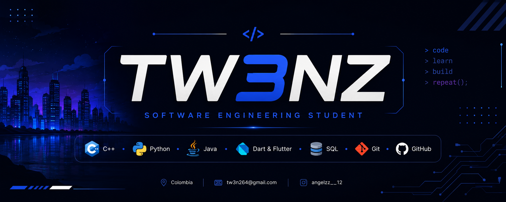

# Miguel | TW3NZ

Estudiante de Ingeniería de Sistemas y de Ciencia de Datos, interesado en el desarrollo de software, el análisis de datos, las estructuras de datos y la creación de aplicaciones. En este espacio documento proyectos académicos, experimento con distintas tecnologías y comparto mi progreso como desarrollador.

## Tecnologías y herramientas

- **Lenguajes:** C++, Java, Python, Dart y SQL.
- **Desarrollo de aplicaciones:** Flutter.
- **Control de versiones:** Git y GitHub.

## Formación e intereses

- **Ingeniería de Sistemas:** quinto semestre.
- **Ciencia de Datos** .
- **Otros intereses:** Machine Learning , desarrollo de software y aplicaciones.

## Proyectos destacados

### [My Daily Routine](https://github.com/TW3NZ/Proyecto-Desarrollo)

Aplicación académica desarrollada con Flutter. **En desarrollo:** actualmente se trabaja en la maquetación visual y la estructura por capas; la lógica funcional todavía no está implementada.

### [Simulador de Rutas Urbanas y Gestión de Pasajeros](https://github.com/TW3NZ/structuresproject)

Proyecto académico de Estructuras de Datos desarrollado en Python. Simula la gestión de pasajeros y rutas urbanas mediante un grafo, una cola y una pila implementados manualmente, e incorpora el algoritmo de Dijkstra para calcular rutas de menor distancia.

## Sobre mí

Me interesa continuar aprendiendo nuevas herramientas y lenguajes, aplicar los conceptos vistos en clase y construir proyectos que reflejen mi evolución en programación.
